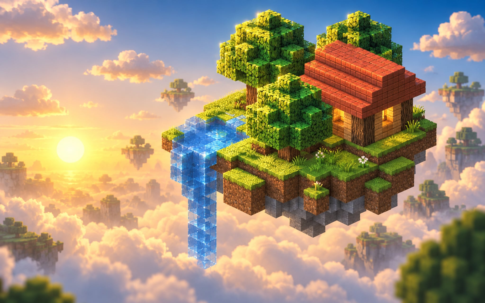
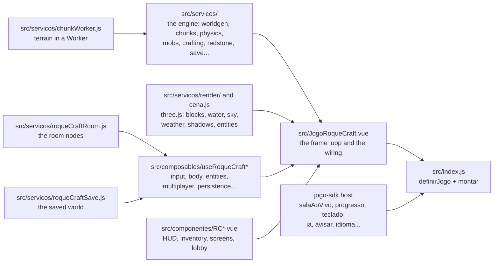

# RoqueCraft

_English | [Português](README.pt-BR.md)_

RoqueCraft from [RoqueOS](https://roqueos.com.br): an infinite, seed-generated 3D block world.
Biomes, caves, ore, day and night, hunger and health; mine, craft, farm, breed animals, build and
travel through portals to other dimensions. Alone or in a room with friends, in the same world, in
real time. Play it at [roqueos.com.br/jogar/roquecraft](https://roqueos.com.br/jogar/roquecraft).



## Why it exists

Until 26/09/2026 this game lived inside the RoqueOS repository and talked directly to the
system's stores, to Firebase (the room in the Realtime Database, the world in Firestore), to
Quasar, to the system i18n and to the villager's LLM provider. Now it is its own open repo in the
[roqueos-games](https://github.com/roqueos-games) organization and talks to RoqueOS only through
the [`jogo-sdk`](https://github.com/roqueos-games/jogo-sdk). The same code runs inside RoqueOS,
standalone in your browser (`yarn dev`) and in tests. The game id is still `roquecraft`, and that
is how the save and the room find each other ([`src/index.js`](src/index.js)).

## Getting started

You need Node 24 (what [`.nvmrc`](.nvmrc) says, 22 at minimum) and Yarn 1.22.

```bash
yarn install --ignore-scripts
yarn dev
yarn verificar
```

`yarn dev` opens the game with the SDK development host, the world saved in `localStorage`
([`dev/main.js`](dev/main.js)). `yarn verificar` is lint, formatting, tests and `jogo check`, the
same as CI ([`.github/workflows/ci.yml`](.github/workflows/ci.yml)). Every step, with what success
looks like, is in [docs/GETTING-STARTED.md](docs/GETTING-STARTED.md).

## How to play

| Action                      | How                                                |
| --------------------------- | -------------------------------------------------- |
| walk, look                  | WASD and the mouse; on a phone, the touch controls |
| jump                        | space                                              |
| sprint, sneak               | Ctrl (or double-tap W), Shift                      |
| break, place                | left button, right button                          |
| inventory                   | E                                                  |
| pick the held item, drop it | 1 to 9, Q                                          |
| map                         | M                                                  |
| fly (creative mode)         | double-tap space, or F                             |
| creative panel              | K                                                  |
| chat (in a room)            | T                                                  |
| close the top screen, pause | Esc                                                |

The villager talks through a language model when the host offers the `ia` capability and says
there is a model right now. Without it, with the model down or slow, it answers with the game's
local lines ([`src/servicos/falaDoRoqueOS.js`](src/servicos/falaDoRoqueOS.js)).

## The parts



| Path                   | What it is                                                                                              |
| ---------------------- | ------------------------------------------------------------------------------------------------------- |
| `src/servicos/`        | the engine, the terrain Worker and the save and room formats                                            |
| `src/servicos/render/` | drawing on the GPU (three.js)                                                                           |
| `src/composables/`     | the parts of the game with a lifecycle                                                                  |
| `src/componentes/`     | the interface (`RC*.vue`) and its styles                                                                |
| `i18n/`                | one JSON per language, with the same keys in all ten                                                    |
| `public/`              | cover and icon; `public/games/roquecraft/` holds textures, art and sound, origin of each in `ASSETS.md` |
| `test/`                | tests with the SDK fake host and a three.js stand-in, nothing from RoqueOS                              |
| `qa/`                  | browser probes and asset generators that came from RoqueOS                                              |
| `docs/`                | this documentation, plus the rule, plans and dev-doc imported from RoqueOS                              |
| `dev/`, `index.html`   | the game alone in the browser, for development                                                          |
| `jogo.json`            | the manifest RoqueOS reads                                                                              |

How the pieces connect, with the flows in sequence diagrams, is in
[docs/ARCHITECTURE.md](docs/ARCHITECTURE.md).

## Project status and limits

Version 0.1.3 ([`package.json`](package.json)), pinned by RoqueOS through the exact tag `v0.1.3`.
Measured on 18/11/2026 in a Linux container: `yarn verificar` is red. `yarn lint`,
`yarn format:check` and `yarn jogo:check` pass; `yarn test` fails 4 of 3572 tests, two because
the probe sweep and the mesher ledger are older than 21 days and two time ceilings in
`test/servicos/perf.spec.js` on that machine. What to do about each is in
[docs/WHEN-IT-BREAKS.md](docs/WHEN-IT-BREAKS.md).

Known limits, each one written down with its source: whoever joins a room has no invite link, the
invite is read once when the game opens, and when the host's connection drops with people in the
room the host's presence stays and succession does not happen (pinned by `it.fails` in
[`test/composables/salaComHostFalso.spec.js`](test/composables/salaComHostFalso.spec.js)). Tests
run in jsdom with a three.js stand-in and say nothing about the GPU. The full list is in
[docs/ARCHITECTURE.md](docs/ARCHITECTURE.md#11-known-limits).

## Documentation

Start at [docs/INDEX.md](docs/INDEX.md). Each document answers one question:

| Question                                          | Document                                   |
| ------------------------------------------------- | ------------------------------------------ |
| from zero to the game running, command by command | [GETTING-STARTED](docs/GETTING-STARTED.md) |
| how it works inside                               | [ARCHITECTURE](docs/ARCHITECTURE.md)       |
| every script, file, constant and format           | [REFERENCE](docs/REFERENCE.md)             |
| releasing, updating without breaking, undoing     | [OPERATIONS](docs/OPERATIONS.md)           |
| symptom, cause, fix                               | [WHEN-IT-BREAKS](docs/WHEN-IT-BREAKS.md)   |
| the words that mean something specific here       | [GLOSSARY](docs/GLOSSARY.md)               |
| adding a block, item, recipe, feature or probe    | [EXTENDING](docs/EXTENDING.md)             |
| how RoqueOS talks to the game                     | [INTEGRATIONS](docs/INTEGRATIONS.md)       |
| what each test suite proves                       | [TESTING](docs/TESTING.md)                 |
| what is decided and not reopened                  | [DECISIONS](docs/DECISIONS.md)             |
| how to contribute                                 | [CONTRIBUTING](CONTRIBUTING.md)            |

Code, comments and commit messages are in Brazilian Portuguese; issues and pull requests in
English are welcome. Security reports go through [SECURITY.md](SECURITY.md).

## License

MIT for the code and the art (cover, icon, menu background). Block textures and item icons are
original, drawn by the generators in `qa/`, and the textures are CC0, as their generator
declares. Sound is CC0 (Kenney and OpenGameArt, plus two synthesized beds). The origin of every
file is in [ASSETS.md](ASSETS.md) and, for sound, also in
`public/games/roquecraft/audio/CREDITOS.md`. See [LICENSE](LICENSE).
