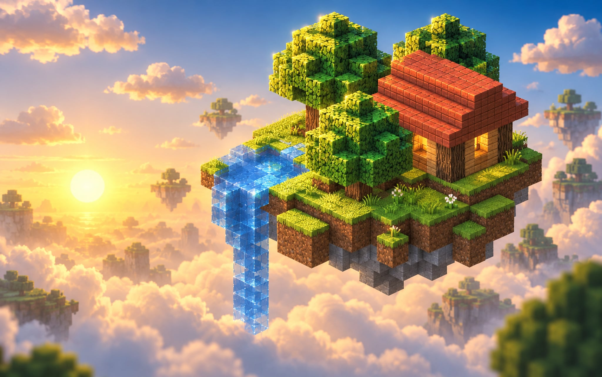
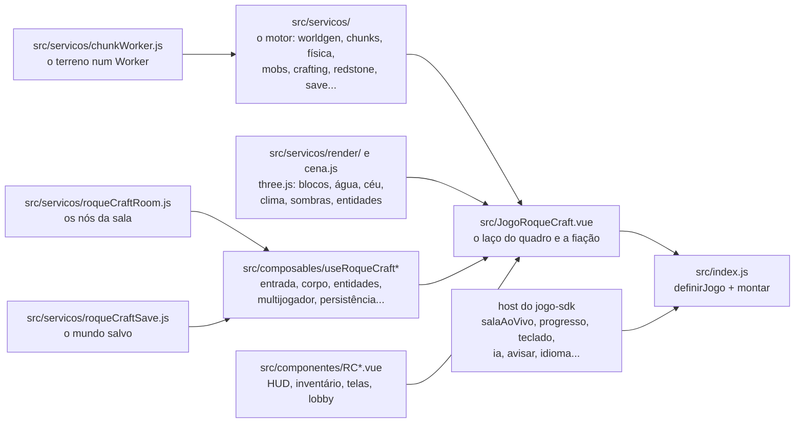

# RoqueCraft

_[English](README.md) | Português_

O RoqueCraft do [RoqueOS](https://roqueos.com.br): um mundo de blocos infinito, gerado por
semente, em 3D. Biomas, cavernas, minério, dia e noite, fome e vida; minere, fabrique, plante, crie
bichos, construa, atravesse portais para outras dimensões. Sozinho ou numa sala com amigos, no
mesmo mundo, em tempo real. Jogue em
[roqueos.com.br/jogar/roquecraft](https://roqueos.com.br/jogar/roquecraft).



## Por que existe

Até 26/09/2026 este jogo morava dentro do repositório do RoqueOS e falava direto com as stores do
sistema, com o Firebase (a sala no Realtime Database, o mundo no Firestore), com o Quasar, com o
i18n do sistema e com o provedor de LLM do aldeão. Agora ele é um repo próprio, aberto, na
organização [roqueos-games](https://github.com/roqueos-games), e fala com o RoqueOS só pelo
[`jogo-sdk`](https://github.com/roqueos-games/jogo-sdk). O mesmo código roda no RoqueOS, sozinho
no seu navegador (`yarn dev`) e no teste. O id do jogo continua `roquecraft`, e é por ele que o
save e a sala se acham ([`src/index.js`](src/index.js)).

## Como começar

Precisa de Node 24 (o que o [`.nvmrc`](.nvmrc) diz, 22 no mínimo) e Yarn 1.22.

```bash
yarn install --ignore-scripts
yarn dev
yarn verificar
```

O `yarn dev` abre o jogo com o host de desenvolvimento do SDK, com o mundo salvo no
`localStorage` ([`dev/main.js`](dev/main.js)). O `yarn verificar` é lint, formato, testes e
`jogo check`, o mesmo do CI ([`.github/workflows/ci.yml`](.github/workflows/ci.yml)). Cada passo,
com o que mostra que deu certo, está em [docs/pt-BR/COMECAR.md](docs/pt-BR/COMECAR.md).

## Como se joga

| Ação                           | Como                                                      |
| ------------------------------ | --------------------------------------------------------- |
| andar, olhar                   | WASD e o mouse; no celular, os controles de toque da tela |
| pular                          | espaço                                                    |
| correr, agachar                | Ctrl (ou dois toques no W), Shift                         |
| quebrar, colocar               | botão esquerdo, botão direito                             |
| inventário                     | E                                                         |
| escolher o item da mão, largar | 1 a 9, Q                                                  |
| mapa                           | M                                                         |
| voar (modo criativo)           | dois toques no espaço, ou F                               |
| painel do criativo             | K                                                         |
| chat (na sala)                 | T                                                         |
| fechar a tela de cima, pausar  | Esc                                                       |

O aldeão conversa por um modelo de linguagem quando o host oferece a capacidade `ia` e diz que há
modelo agora. Sem ela, com o modelo fora do ar ou demorando, ele responde com as falas locais do
jogo ([`src/servicos/falaDoRoqueOS.js`](src/servicos/falaDoRoqueOS.js)).

## As partes



| Caminho                | O que é                                                                                                   |
| ---------------------- | --------------------------------------------------------------------------------------------------------- |
| `src/servicos/`        | o motor, o Worker do terreno e o formato do save e da sala                                                |
| `src/servicos/render/` | o desenho na GPU (three.js)                                                                               |
| `src/composables/`     | as partes do jogo com ciclo de vida                                                                       |
| `src/componentes/`     | a interface (`RC*.vue`) e os estilos dela                                                                 |
| `i18n/`                | um JSON por idioma, com as mesmas chaves nos dez                                                          |
| `public/`              | capa e ícone; `public/games/roquecraft/` tem texturas, arte e som, com a origem de cada um no `ASSETS.md` |
| `test/`                | testes com o host falso do SDK e um dublê do three.js, sem nada do RoqueOS                                |
| `qa/`                  | os roteiros de navegador e os geradores de asset que vieram do RoqueOS                                    |
| `docs/`                | esta documentação, mais a regra, os planos e o dev-doc importados do RoqueOS                              |
| `dev/`, `index.html`   | o jogo sozinho no navegador, para desenvolver                                                             |
| `jogo.json`            | o manifesto que o RoqueOS lê                                                                              |

Como as peças se ligam, com os fluxos em diagrama de sequência, está em
[docs/pt-BR/ARQUITETURA.md](docs/pt-BR/ARQUITETURA.md).

## Estado do projeto e limites

Versão 0.1.3 ([`package.json`](package.json)), pinada pelo RoqueOS pela tag exata `v0.1.3`.
Medido em 18/11/2026 num contêiner Linux: o `yarn verificar` está vermelho. `yarn lint`,
`yarn format:check` e `yarn jogo:check` passam; o `yarn test` reprova 4 de 3572 testes, dois porque
a varredura das sondas e o ledger do mesher passaram de 21 dias e dois tetos de tempo do
`test/servicos/perf.spec.js` naquela máquina. O que fazer com cada um está em
[docs/pt-BR/QUANDO-QUEBRA.md](docs/pt-BR/QUANDO-QUEBRA.md).

Limites conhecidos, cada um escrito com a fonte: quem entra numa sala não tem o link do convite, o
convite é lido uma vez quando o jogo abre, e quando a conexão do anfitrião cai com gente na sala a
presença dele fica e a sucessão não acontece (pinado por `it.fails` em
[`test/composables/salaComHostFalso.spec.js`](test/composables/salaComHostFalso.spec.js)). O teste
roda no jsdom com um dublê do three.js e não diz nada sobre a GPU. A lista inteira está em
[docs/pt-BR/ARQUITETURA.md](docs/pt-BR/ARQUITETURA.md#11-limites-conhecidos).

## Documentação

Comece pelo [docs/pt-BR/INDEX.md](docs/pt-BR/INDEX.md). Cada documento responde uma pergunta:

| Pergunta                                           | Documento                                    |
| -------------------------------------------------- | -------------------------------------------- |
| do zero ao jogo rodando, comando a comando         | [COMECAR](docs/pt-BR/COMECAR.md)             |
| como é por dentro                                  | [ARQUITETURA](docs/pt-BR/ARQUITETURA.md)     |
| todo script, arquivo, constante e formato          | [REFERENCIA](docs/pt-BR/REFERENCIA.md)       |
| publicar, atualizar sem quebrar, desfazer          | [OPERACAO](docs/pt-BR/OPERACAO.md)           |
| sintoma, causa, conserto                           | [QUANDO-QUEBRA](docs/pt-BR/QUANDO-QUEBRA.md) |
| as palavras que significam coisa específica aqui   | [GLOSSARIO](docs/pt-BR/GLOSSARIO.md)         |
| acrescentar bloco, item, receita, recurso ou sonda | [ESTENDER](docs/pt-BR/ESTENDER.md)           |
| como o RoqueOS conversa com o jogo                 | [INTEGRACOES](docs/pt-BR/INTEGRACOES.md)     |
| o que cada suíte de teste prova                    | [TESTES](docs/pt-BR/TESTES.md)               |
| o que está decidido e não se reabre                | [DECISOES](docs/pt-BR/DECISOES.md)           |
| como contribuir                                    | [CONTRIBUTING](docs/pt-BR/CONTRIBUTING.md)   |

O código, os comentários e as mensagens de commit são em português do Brasil; issue e PR em inglês
são bem-vindos. Relato de segurança vai pelo [SECURITY.md](SECURITY.md).

## Licença

MIT no código e na arte (capa, ícone, fundo do menu). As texturas dos blocos e os ícones de item são
autorais, desenhados pelos geradores de `qa/`, e as texturas são CC0, como o gerador delas declara.
O som é CC0 (Kenney e OpenGameArt, mais dois leitos sintetizados). A origem de cada arquivo está no
[ASSETS.md](ASSETS.md) e, a do som, também no `public/games/roquecraft/audio/CREDITOS.md`. Veja
[LICENSE](LICENSE).
