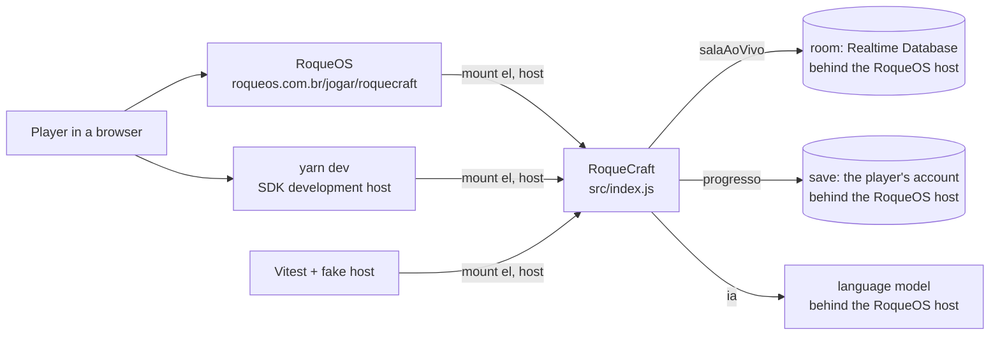
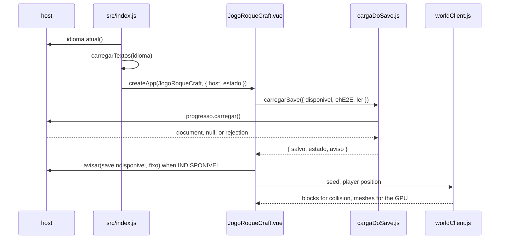
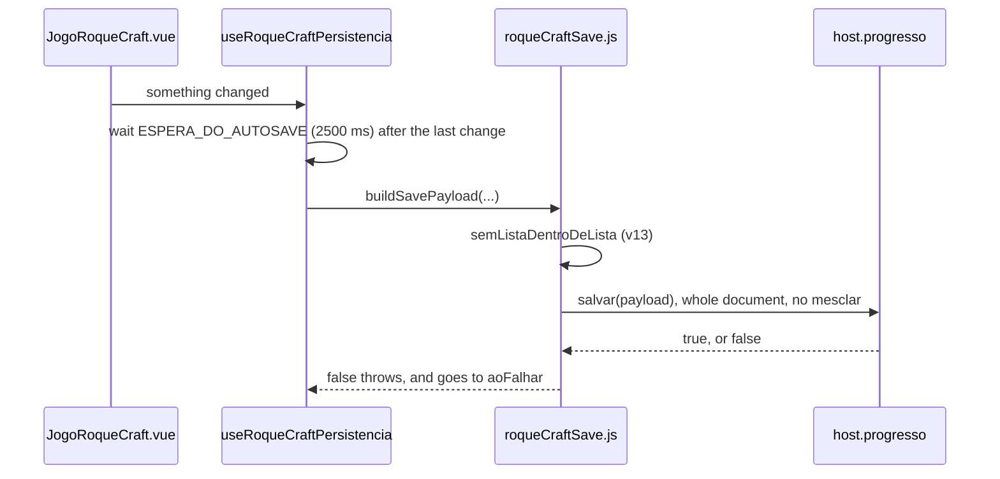
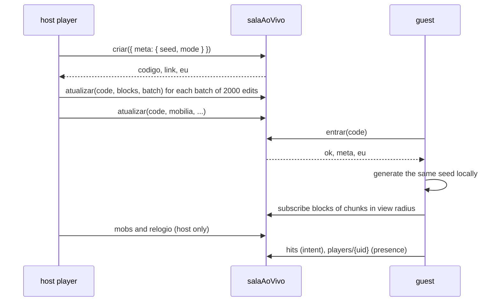

# Architecture

_English | [Português](pt-BR/ARQUITETURA.md)_

> **For whom:** whoever changes the engine, the rendering, the room or the save, and whoever reviews it.
> **What is here:** the idea, the context, the processes, the components with their files, the main flows, the data, the design decisions and the known limits.
> **Where to go for the rest:** every constant and file in [REFERENCE.md](REFERENCE.md); the contract with RoqueOS in [INTEGRATIONS.md](INTEGRATIONS.md); what is settled in [DECISIONS.md](DECISIONS.md).

## Summary

1. [The idea](#1-the-idea)
2. [Context](#2-context)
3. [Processes and where they run](#3-processes-and-where-they-run)
4. [Components](#4-components)
5. [Where each thing is born](#5-where-each-thing-is-born)
6. [Main flows](#6-main-flows)
7. [Data and contracts](#7-data-and-contracts)
8. [Secrets](#8-secrets)
9. [How the diagrams are made](#9-how-the-diagrams-are-made)
10. [Design decisions](#10-design-decisions)
11. [Known limits](#11-known-limits)

## 1. The idea

The world is infinite, so nothing stores voxels. Terrain comes from a seed: every client runs the
same generator ([`src/servicos/worldgen.js`](../src/servicos/worldgen.js)) and gets the same
chunk. What is stored and what travels is only the difference from the seed (the player's edits)
and the state of the player, the furniture, the mobs and the clock. The game is a pure engine in
`src/servicos/`, a few lifecycle pieces in `src/composables/`, screens in `src/componentes/`, and
one component, [`src/JogoRoqueCraft.vue`](../src/JogoRoqueCraft.vue), that only wires them. It
reaches the outside world only through the capabilities of the `jogo-sdk` host.

## 2. Context



Who uses it: players inside RoqueOS, the developer in `yarn dev`, and the tests. What it depends
on: `vue`, `three` and `qrcode` as peers provided by RoqueOS, and `@roqueos-games/jogo-sdk` pinned
by tag `v0.3.0` ([`package.json`](../package.json)).

What happens when a dependency fails. Without `progresso` available (a guest, or no account) the
game plays and does not save. When the save read fails, the game warns with a fixed notice and
does not write over the saved world ([`src/servicos/cargaDoSave.js`](../src/servicos/cargaDoSave.js)).
Without `ia`, or with the model down, the villager uses local lines. Without a WebGL context the
engine shows an error with a retry button instead of hanging on the loading screen
([`src/servicos/render/engine.js`](../src/servicos/render/engine.js)). When the Worker does not
start, the same pipeline runs inline in a `requestIdleCallback` loop
([`src/servicos/worldClient.js`](../src/servicos/worldClient.js)).

## 3. Processes and where they run

| Process         | Where                       | What it does                                                      | File                                                            |
| --------------- | --------------------------- | ----------------------------------------------------------------- | --------------------------------------------------------------- |
| main thread     | the page's window           | input, physics, mobs, screens, three.js rendering, the frame loop | [`src/JogoRoqueCraft.vue`](../src/JogoRoqueCraft.vue)           |
| terrain Worker  | a module Web Worker         | generation, lighting and meshing of chunks, in short slices       | [`src/servicos/chunkWorker.js`](../src/servicos/chunkWorker.js) |
| inline fallback | main thread, idle callbacks | the same pipeline when the Worker does not start                  | [`src/servicos/worldClient.js`](../src/servicos/worldClient.js) |
| host            | RoqueOS, dev host or fake   | account, room, save, notices, language, keyboard, model           | `@roqueos-games/jogo-sdk`                                       |

The Worker works in short slices (`tick`) separated by `setTimeout(0)`, so it keeps answering
messages (the player moved, broke a block, changed render distance) instead of locking up in one
long burst ([`src/servicos/chunkWorker.js`](../src/servicos/chunkWorker.js)).

## 4. Components

| Component        | What it is                                                                                       | Where                                                                                                                        |
| ---------------- | ------------------------------------------------------------------------------------------------ | ---------------------------------------------------------------------------------------------------------------------------- |
| entry            | `definirJogo`, a Vue app of its own inside the host's element, returns `{ ativar, desmontar }`   | [`src/index.js`](../src/index.js)                                                                                            |
| wiring           | the frame loop, the order composables are created, the QA hook                                   | [`src/JogoRoqueCraft.vue`](../src/JogoRoqueCraft.vue)                                                                        |
| world generation | terrain, caves, ore and features in four passes, deterministic by seed                           | [`src/servicos/worldgen.js`](../src/servicos/worldgen.js)                                                                    |
| other dimensions | Nether and End generation; the registry of heights per dimension                                 | [`src/servicos/dimensoes.js`](../src/servicos/dimensoes.js)                                                                  |
| blocks and items | the block registry with stable numeric ids, the item registry, recipes                           | [`blocks.js`](../src/servicos/blocks.js), [`items.js`](../src/servicos/items.js), [`recipes.js`](../src/servicos/recipes.js) |
| mesher           | greedy meshing with ambient occlusion, smooth light, texture array and biome tint                | [`src/servicos/mesher.js`](../src/servicos/mesher.js)                                                                        |
| render           | renderer, quality profiles, camera, fog, lights, sky, post-processing                            | [`src/servicos/render/engine.js`](../src/servicos/render/engine.js)                                                          |
| scene assembly   | textures, engine, audio and entity layer, created in order                                       | [`src/servicos/cena.js`](../src/servicos/cena.js)                                                                            |
| room             | the room nodes over `salaAoVivo`, chunk-scoped subscriptions, succession                         | [`src/servicos/roqueCraftRoom.js`](../src/servicos/roqueCraftRoom.js)                                                        |
| save             | payload, `parseSave`, read and write over `progresso`                                            | [`src/servicos/roqueCraftSave.js`](../src/servicos/roqueCraftSave.js)                                                        |
| save boundary    | lists inside lists become `{ _a: [...] }` on the way out and back                                | [`src/servicos/documentoDoSave.js`](../src/servicos/documentoDoSave.js)                                                      |
| load states      | `NAO_TENTOU`, `CARREGADO`, `VAZIO`, `INDISPONIVEL` and whether it may save                       | [`src/servicos/cargaDoSave.js`](../src/servicos/cargaDoSave.js)                                                              |
| villager speech  | the only file of the conversation that knows the host                                            | [`src/servicos/falaDoRoqueOS.js`](../src/servicos/falaDoRoqueOS.js)                                                          |
| QA hook          | `window.__roquecraft`, only in E2E mode                                                          | [`src/servicos/ganchoDeQA.js`](../src/servicos/ganchoDeQA.js)                                                                |
| composables      | input, body, entities, living world, multiplayer, persistence, quality, screens, weather, panels | [`src/composables/`](../src/composables/)                                                                                    |
| screens          | HUD, inventory, container, trade, creative panel, lobby, pause, start, minimap, touch controls   | [`src/componentes/`](../src/componentes/)                                                                                    |
| texts            | one JSON per language, loaded as `?raw`                                                          | [`src/textos.js`](../src/textos.js), [`i18n/`](../i18n/)                                                                     |

## 5. Where each thing is born

The rule came from RoqueOS (rule 44, kept as imported in
[`regras/44-roquecraft-arquitetura.md`](regras/44-roquecraft-arquitetura.md), with the front's
paths). A new feature is born in a service or a composable; the `.vue` only gains wiring. Pure,
deterministic rule with no Vue and no timer goes to `src/servicos/*.js`; drawing, shader, mesh
and material to `src/servicos/render/`; state with a lifecycle (timer, subscription, listener) to
`src/composables/useRoqueCraft*.js`, with an `encerrar()` called on unmount; a piece of interface
with its own template to `src/componentes/RC*.vue`; QA and E2E surface to `src/servicos/qaDe*.js`.

Every `let` of the component enters a module through a getter, never by value: `engine` and
`world` are recreated on a quality change and on a new world, and a module that captured the
value would talk to the dead engine for the whole session. A `let` the module writes enters as a
getter and setter pair.

## 6. Main flows

### Opening the world



The app mounts only once the texts are loaded, so the start screen never shows without labels
([`src/index.js`](../src/index.js)). Without `progresso` available, or in E2E mode, the game does
not even ask the host: the state is `NAO_TENTOU`, not `VAZIO`, because a new player may save and a
harness must not ([`src/servicos/cargaDoSave.js`](../src/servicos/cargaDoSave.js)).

### Autosave



Saving does not happen without `progresso` available, inside a room (the world belongs to the
host) or in E2E mode, and not when the read failed ([`useRoqueCraftPersistencia.js`](../src/composables/useRoqueCraftPersistencia.js)).

### Room: create and join



Terrain never travels: everyone runs the generator with the same seed, and `blocks` holds only
the difference, keyed by chunk and local index, so the last write wins and nothing grows forever
([`src/servicos/roqueCraftRoom.js`](../src/servicos/roqueCraftRoom.js)). The host simulates the
mobs and the clock; the guest draws what arrives and sends intents. When the host leaves and
there are other people, `sucessorDoAnfitriao` picks the next one.

## 7. Data and contracts

The save document is version 13 ([`buildSavePayload`](../src/servicos/roqueCraftSave.js)). A
trimmed example, field names as in the code:

```json
{
  "version": 13,
  "worldId": "w771102",
  "dimensionId": "overworld",
  "generatorVersion": 1,
  "seed": 771102,
  "mode": "survival",
  "edits": [0, 0, 1234, 5],
  "outrasDimensoes": [],
  "player": { "x": 8.5, "y": 70, "z": 8.5, "yaw": 0, "pitch": 0 },
  "inventory": [],
  "survival": null,
  "efeitos": null,
  "ticks": 1000,
  "hotbar": 0,
  "settings": null,
  "mobilia": [],
  "renascimento": null,
  "dragaoMorto": false,
  "drops": [],
  "mobs": [],
  "updatedAt": 0
}
```

`edits` is a flat array `[cx, cz, li, id, ...]`, where `li` is the local index inside the chunk
column. `parseSave` reads any older version: a missing field becomes its default, so a v1 save
opens. The room nodes are in [INTEGRATIONS.md](INTEGRATIONS.md#3-the-room-salaaovivo).

## 8. Secrets

The game holds none. The language model key stays on the host side: the game calls only
`host.ia.completar`, and the comment in [`falaDoRoqueOS.js`](../src/servicos/falaDoRoqueOS.js)
records that a provider key inside the game would be an exposed key. The browser path with a key
(`criarModeloDoNpc` and the `PROVEDORES` table) was removed in the extraction
([`src/servicos/modeloDoNpc.js`](../src/servicos/modeloDoNpc.js)). CI reads no secret
([`.github/workflows/ci.yml`](../.github/workflows/ci.yml)).

## 9. How the diagrams are made

All diagrams are Mermaid inside the Markdown, rendered by GitHub. The source is the text, and the
Portuguese pair translates the labels. There is no image to regenerate.

## 10. Design decisions

| Decided                                                              | Rejected alternative                         | Why                                                                                                                                                  | When              |
| -------------------------------------------------------------------- | -------------------------------------------- | ---------------------------------------------------------------------------------------------------------------------------------------------------- | ----------------- |
| talk to RoqueOS only through `jogo-sdk` capabilities                 | importing RoqueOS stores and Firebase        | the same code runs in RoqueOS, `yarn dev` and tests; `jogo check` fails on a `firebase` import                                                       | 25/09/2026        |
| a Vue app of its own inside the host's element                       | a component inside the RoqueOS app           | no store, plugin or global style of RoqueOS reaches the game ([`src/index.js`](../src/index.js))                                                     | 25/09/2026        |
| seed plus edits, never voxels                                        | storing or sending chunks                    | the world is infinite                                                                                                                                | before extraction |
| chunk-scoped room subscriptions                                      | subscribing to every block of the room       | joining would download the whole world, with no ceiling                                                                                              | before extraction |
| lists inside lists become `{ _a: [...] }` at the boundary (save v13) | a new format in each of the four serializers | Firestore refuses nested arrays; one rule at the boundary also catches the fifth field                                                               | 30/09/2026        |
| a failed read never saves over the world (RC-02)                     | treating "could not read" as "no save"       | a three-second network drop at boot used to overwrite months of building                                                                             | before extraction |
| Worker created with `new Worker(new URL(...), { type: 'module' })`   | other Worker patterns                        | it is what the RoqueOS Vite bundles when it comes from a dependency                                                                                  | 25/09/2026        |
| game JSON loaded as `?raw` and `JSON.parse`                          | importing JSON directly                      | the RoqueOS build breaks on a direct JSON import (`orgTransform.apply is not a function`), measured 25/09/2026 ([`src/textos.js`](../src/textos.js)) | 25/09/2026        |
| `three` and `qrcode` as peers, pinned to the RoqueOS versions        | bundling them                                | the tests and `yarn dev` see what the player sees                                                                                                    | 25/09/2026        |

Product decisions that must not be reopened by accident are in [DECISIONS.md](DECISIONS.md).

## 11. Known limits

- Whoever joins a room has no invite link (the contract gives the link only to the creator): the
  QR is empty and "copy invite" copies the code.
- The invite is read once, when the game opens. A second invite with the window already open does
  not reach the game.
- When the host's connection drops with people in the room, the host's presence stays and
  succession does not happen. It was like this before the extraction; the test is marked
  `it.fails` in [`test/composables/salaComHostFalso.spec.js`](../test/composables/salaComHostFalso.spec.js).
- The "sign in" notice appears after the host refuses the room, not before the click.
- Tests run in jsdom with a three.js stand-in ([`test/threeStub.js`](../test/threeStub.js)). Green
  tests say nothing about the GPU; GPU code needs evidence on a real iPhone.
- The block and item tables are sized by `TABELA_DE_IDS` (512) in
  [`src/servicos/blocks.js`](../src/servicos/blocks.js); the 513th id would read nothing.
- The SDK development host has no account and no `ia`, and makes the room between tabs of the same
  browser through `localStorage`. It does not emulate the database rules.
- Most probes in `qa/` were written for the RoqueOS build; which ones run against this repo is in
  [`qa/README.md`](../qa/README.md).
