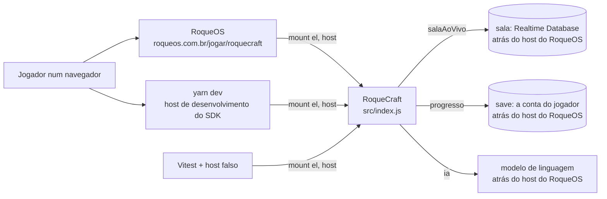
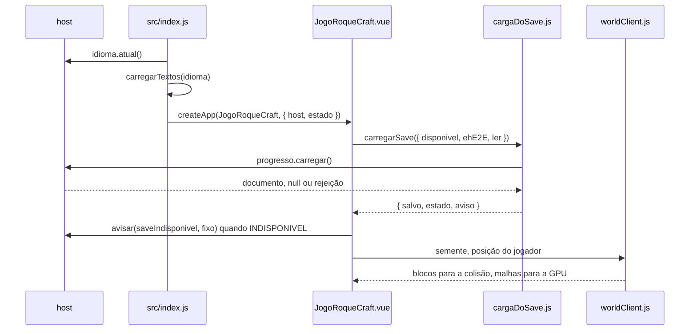
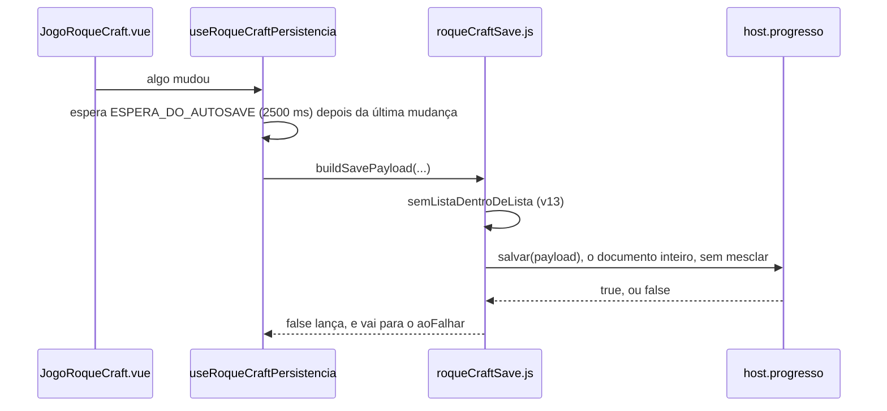
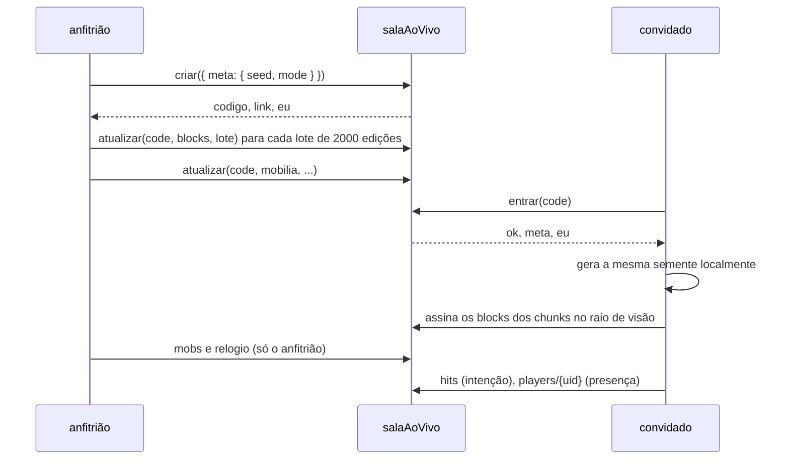

# Arquitetura

_[English](../ARCHITECTURE.md) | Português_

> **Para quem:** quem muda o motor, o desenho, a sala ou o save, e quem revisa.
> **O que tem aqui:** a ideia, o contexto, os processos, os componentes com o arquivo de cada um, os fluxos principais, os dados, as decisões de design e os limites conhecidos.
> **Onde ir para o resto:** toda constante e arquivo em [REFERENCIA.md](REFERENCIA.md); o contrato com o RoqueOS em [INTEGRACOES.md](INTEGRACOES.md); o que está decidido em [DECISOES.md](DECISOES.md).

## Sumário

1. [A ideia](#1-a-ideia)
2. [Contexto](#2-contexto)
3. [Processos e onde rodam](#3-processos-e-onde-rodam)
4. [Componentes](#4-componentes)
5. [Onde cada coisa nasce](#5-onde-cada-coisa-nasce)
6. [Fluxos principais](#6-fluxos-principais)
7. [Dados e contratos](#7-dados-e-contratos)
8. [Segredos](#8-segredos)
9. [Como os diagramas são feitos](#9-como-os-diagramas-são-feitos)
10. [Decisões de design](#10-decisões-de-design)
11. [Limites conhecidos](#11-limites-conhecidos)

## 1. A ideia

O mundo é infinito, então nada guarda voxel. O terreno sai de uma semente: todo cliente roda o
mesmo gerador ([`src/servicos/worldgen.js`](../../src/servicos/worldgen.js)) e recebe o mesmo
chunk. O que se guarda e o que trafega é só a diferença em relação à semente (as edições do
jogador) e o estado do jogador, da mobília, dos bichos e do relógio. O jogo é um motor puro em
`src/servicos/`, umas poucas peças com ciclo de vida em `src/composables/`, telas em
`src/componentes/` e um componente, [`src/JogoRoqueCraft.vue`](../../src/JogoRoqueCraft.vue), que só
liga uma coisa na outra. Ele alcança o mundo de fora só pelas capacidades do host do `jogo-sdk`.

## 2. Contexto



Quem usa: o jogador dentro do RoqueOS, quem desenvolve no `yarn dev`, e o teste. Do que depende:
`vue`, `three` e `qrcode` como peers fornecidos pelo RoqueOS, e o `@roqueos-games/jogo-sdk` pinado
pela tag `v0.3.0` ([`package.json`](../../package.json)).

O que acontece quando uma dependência falha. Sem o `progresso` disponível (convidado, ou sem conta)
o jogo roda e não grava. Quando a leitura do save falha, o jogo avisa com um aviso fixo e não grava
por cima do mundo salvo ([`src/servicos/cargaDoSave.js`](../../src/servicos/cargaDoSave.js)). Sem
`ia`, ou com o modelo fora, o aldeão usa as falas locais. Sem contexto WebGL o motor mostra erro com
botão de tentar de novo, em vez de ficar preso no carregando
([`src/servicos/render/engine.js`](../../src/servicos/render/engine.js)). Quando o Worker não sobe, o
mesmo pipeline roda inline num laço de `requestIdleCallback`
([`src/servicos/worldClient.js`](../../src/servicos/worldClient.js)).

## 3. Processos e onde rodam

| Processo          | Onde                                      | O que faz                                                              | Arquivo                                                            |
| ----------------- | ----------------------------------------- | ---------------------------------------------------------------------- | ------------------------------------------------------------------ |
| thread principal  | a janela da página                        | entrada, física, bichos, telas, desenho com three.js, o laço do quadro | [`src/JogoRoqueCraft.vue`](../../src/JogoRoqueCraft.vue)           |
| Worker do terreno | um Web Worker de módulo                   | geração, luz e malha dos chunks, em fatias curtas                      | [`src/servicos/chunkWorker.js`](../../src/servicos/chunkWorker.js) |
| recuo inline      | thread principal, em idle callbacks       | o mesmo pipeline quando o Worker não sobe                              | [`src/servicos/worldClient.js`](../../src/servicos/worldClient.js) |
| host              | RoqueOS, host de desenvolvimento ou falso | conta, sala, save, avisos, idioma, teclado, modelo                     | `@roqueos-games/jogo-sdk`                                          |

O Worker trabalha em fatias curtas (`tick`) separadas por `setTimeout(0)`, para continuar
respondendo mensagens (o jogador andou, quebrou um bloco, mudou a distância de renderização) em vez
de travar numa rajada longa ([`src/servicos/chunkWorker.js`](../../src/servicos/chunkWorker.js)).

## 4. Componentes

| Componente        | O que é                                                                                                | Onde                                                                                                                                  |
| ----------------- | ------------------------------------------------------------------------------------------------------ | ------------------------------------------------------------------------------------------------------------------------------------- |
| entrada           | `definirJogo`, um app Vue próprio dentro do elemento do host, devolve `{ ativar, desmontar }`          | [`src/index.js`](../../src/index.js)                                                                                                  |
| fiação            | o laço do quadro, a ordem em que os composables nascem, o gancho de QA                                 | [`src/JogoRoqueCraft.vue`](../../src/JogoRoqueCraft.vue)                                                                              |
| geração do mundo  | terreno, cavernas, minério e features em quatro passes, determinístico pela semente                    | [`src/servicos/worldgen.js`](../../src/servicos/worldgen.js)                                                                          |
| outras dimensões  | a geração do Nether e do Fim; o registro das alturas por dimensão                                      | [`src/servicos/dimensoes.js`](../../src/servicos/dimensoes.js)                                                                        |
| blocos e itens    | o registro de blocos com id numérico estável, o de itens, as receitas                                  | [`blocks.js`](../../src/servicos/blocks.js), [`items.js`](../../src/servicos/items.js), [`recipes.js`](../../src/servicos/recipes.js) |
| mesher            | malha greedy com oclusão de ambiente, luz suave, texture array e tinta por bioma                       | [`src/servicos/mesher.js`](../../src/servicos/mesher.js)                                                                              |
| render            | renderer, perfis de qualidade, câmera, névoa, luzes, céu, pós-processamento                            | [`src/servicos/render/engine.js`](../../src/servicos/render/engine.js)                                                                |
| montagem da cena  | texturas, motor, áudio e camada de entidades, criados em ordem                                         | [`src/servicos/cena.js`](../../src/servicos/cena.js)                                                                                  |
| sala              | os nós da sala sobre a `salaAoVivo`, assinatura por chunk, sucessão                                    | [`src/servicos/roqueCraftRoom.js`](../../src/servicos/roqueCraftRoom.js)                                                              |
| save              | payload, `parseSave`, leitura e gravação sobre o `progresso`                                           | [`src/servicos/roqueCraftSave.js`](../../src/servicos/roqueCraftSave.js)                                                              |
| fronteira do save | lista dentro de lista vira `{ _a: [...] }` na ida e volta na volta                                     | [`src/servicos/documentoDoSave.js`](../../src/servicos/documentoDoSave.js)                                                            |
| estados da carga  | `NAO_TENTOU`, `CARREGADO`, `VAZIO`, `INDISPONIVEL` e se pode gravar                                    | [`src/servicos/cargaDoSave.js`](../../src/servicos/cargaDoSave.js)                                                                    |
| fala do aldeão    | o único arquivo da conversa que conhece o host                                                         | [`src/servicos/falaDoRoqueOS.js`](../../src/servicos/falaDoRoqueOS.js)                                                                |
| gancho de QA      | `window.__roquecraft`, só em modo E2E                                                                  | [`src/servicos/ganchoDeQA.js`](../../src/servicos/ganchoDeQA.js)                                                                      |
| composables       | entrada, corpo, entidades, mundo vivo, multijogador, persistência, qualidade, telas, clima, painéis    | [`src/composables/`](../../src/composables/)                                                                                          |
| telas             | HUD, inventário, baú, comércio, painel do criativo, lobby, pausa, início, minimapa, controles de toque | [`src/componentes/`](../../src/componentes/)                                                                                          |
| textos            | um JSON por idioma, carregado com `?raw`                                                               | [`src/textos.js`](../../src/textos.js), [`i18n/`](../../i18n/)                                                                        |

## 5. Onde cada coisa nasce

A regra veio do RoqueOS (a rule 44, guardada como chegou em
[`regras/44-roquecraft-arquitetura.md`](../regras/44-roquecraft-arquitetura.md), com os caminhos do
front). Recurso novo nasce em serviço ou composable; o `.vue` só ganha fiação. Regra pura,
determinística, sem Vue e sem timer vai para `src/servicos/*.js`; desenho, shader, malha e material
para `src/servicos/render/`; estado com ciclo de vida (timer, assinatura, listener) para
`src/composables/useRoqueCraft*.js`, com um `encerrar()` chamado no desmonte; pedaço de interface
com template próprio para `src/componentes/RC*.vue`; superfície de QA e E2E para
`src/servicos/qaDe*.js`.

Todo `let` do componente entra num módulo por getter, nunca por valor: `engine` e `world` são
recriados na troca de qualidade e no mundo novo, e um módulo que capturou o valor falaria a sessão
inteira com o motor morto. Um `let` que o módulo escreve entra como par de getter e setter.

## 6. Fluxos principais

### Abrir o mundo



O app só monta com os textos carregados, para a tela inicial nunca aparecer sem rótulo
([`src/index.js`](../../src/index.js)). Sem o `progresso` disponível, ou em modo E2E, o jogo nem
pergunta ao host: o estado é `NAO_TENTOU`, não `VAZIO`, porque jogador novo pode gravar e harness não
pode ([`src/servicos/cargaDoSave.js`](../../src/servicos/cargaDoSave.js)).

### Autosave



Não grava sem o `progresso` disponível, dentro de uma sala (o mundo é do anfitrião) nem em modo E2E,
e não grava quando a leitura falhou ([`useRoqueCraftPersistencia.js`](../../src/composables/useRoqueCraftPersistencia.js)).

### Sala: criar e entrar



O terreno nunca trafega: todo mundo roda o gerador com a mesma semente, e `blocks` guarda só a
diferença, indexada por chunk e índice local, então o último a escrever vence e nada cresce para
sempre ([`src/servicos/roqueCraftRoom.js`](../../src/servicos/roqueCraftRoom.js)). O anfitrião
simula os bichos e o relógio; o convidado desenha o que chega e manda intenções. Quando o anfitrião
sai e há mais gente, o `sucessorDoAnfitriao` escolhe o próximo.

## 7. Dados e contratos

O documento do save é a versão 13 ([`buildSavePayload`](../../src/servicos/roqueCraftSave.js)). Um
exemplo recortado, com os nomes de campo do código:

```json
{
  "version": 13,
  "worldId": "w771102",
  "dimensionId": "overworld",
  "generatorVersion": 1,
  "seed": 771102,
  "mode": "survival",
  "edits": [0, 0, 1234, 5],
  "outrasDimensoes": [],
  "player": { "x": 8.5, "y": 70, "z": 8.5, "yaw": 0, "pitch": 0 },
  "inventory": [],
  "survival": null,
  "efeitos": null,
  "ticks": 1000,
  "hotbar": 0,
  "settings": null,
  "mobilia": [],
  "renascimento": null,
  "dragaoMorto": false,
  "drops": [],
  "mobs": [],
  "updatedAt": 0
}
```

`edits` é um array plano `[cx, cz, li, id, ...]`, em que `li` é o índice local dentro da coluna do
chunk. O `parseSave` lê qualquer versão anterior: campo que falta vira o padrão, então um save v1
abre. Os nós da sala estão em [INTEGRACOES.md](INTEGRACOES.md#3-a-sala-salaaovivo).

## 8. Segredos

O jogo não guarda nenhum. A chave do modelo de linguagem fica do lado do host: o jogo só chama
`host.ia.completar`, e o comentário em [`falaDoRoqueOS.js`](../../src/servicos/falaDoRoqueOS.js)
registra que uma chave de provedor dentro do jogo seria uma chave exposta. O caminho com chave no
navegador (`criarModeloDoNpc` e a tabela `PROVEDORES`) saiu na extração
([`src/servicos/modeloDoNpc.js`](../../src/servicos/modeloDoNpc.js)). O CI não lê segredo nenhum
([`.github/workflows/ci.yml`](../../.github/workflows/ci.yml)).

## 9. Como os diagramas são feitos

Todo diagrama é Mermaid dentro do Markdown, desenhado pelo GitHub. A fonte é o texto, e o par em
inglês traduz os rótulos. Não há imagem para regenerar.

## 10. Decisões de design

| Decidido                                                           | Alternativa recusada                                 | Motivo                                                                                                                                                      | Quando            |
| ------------------------------------------------------------------ | ---------------------------------------------------- | ----------------------------------------------------------------------------------------------------------------------------------------------------------- | ----------------- |
| falar com o RoqueOS só pelas capacidades do `jogo-sdk`             | importar as stores do RoqueOS e o Firebase           | o mesmo código roda no RoqueOS, no `yarn dev` e no teste; o `jogo check` reprova import de `firebase`                                                       | 25/09/2026        |
| um app Vue próprio dentro do elemento do host                      | um componente dentro do app do RoqueOS               | nenhuma store, plugin ou estilo global do RoqueOS chega ao jogo ([`src/index.js`](../../src/index.js))                                                      | 25/09/2026        |
| semente mais edições, nunca voxel                                  | guardar ou mandar chunks                             | o mundo é infinito                                                                                                                                          | antes da extração |
| assinatura da sala por chunk                                       | assinar todos os blocos da sala                      | entrar baixaria o mundo inteiro, sem teto                                                                                                                   | antes da extração |
| lista dentro de lista vira `{ _a: [...] }` na fronteira (save v13) | um formato novo em cada um dos quatro serializadores | o Firestore recusa array dentro de array; uma regra na fronteira pega também o quinto campo                                                                 | 30/09/2026        |
| leitura que falhou nunca grava por cima do mundo (RC-02)           | tratar "não consegui ler" como "não há save"         | uma queda de rede de três segundos no boot gravava por cima de meses de construção                                                                          | antes da extração |
| Worker criado com `new Worker(new URL(...), { type: 'module' })`   | outros padrões de Worker                             | é o que o Vite do RoqueOS empacota quando vem de dependência                                                                                                | 25/09/2026        |
| JSON do jogo carregado com `?raw` e `JSON.parse`                   | importar JSON direto                                 | o build do RoqueOS quebra com import de JSON direto (`orgTransform.apply is not a function`), medido em 25/09/2026 ([`src/textos.js`](../../src/textos.js)) | 25/09/2026        |
| `three` e `qrcode` como peers, nas versões do RoqueOS              | empacotar os dois                                    | o teste e o `yarn dev` veem o que o jogador vê                                                                                                              | 25/09/2026        |

As decisões de produto que não podem ser reabertas por acaso estão em [DECISOES.md](DECISOES.md).

## 11. Limites conhecidos

- Quem entra numa sala não tem o link do convite (o contrato só dá o link a quem cria): o QR fica
  vazio e "copiar convite" copia o código.
- O convite é lido uma vez, quando o jogo abre. Um segundo convite com a janela já aberta não chega
  ao jogo.
- Quando a conexão do anfitrião cai com gente na sala, a presença dele fica e a sucessão não
  acontece. Era assim antes da extração; o teste está marcado com `it.fails` em
  [`test/composables/salaComHostFalso.spec.js`](../../test/composables/salaComHostFalso.spec.js).
- O aviso de "entre na sua conta" aparece depois que o host recusa a sala, não antes do clique.
- O teste roda no jsdom com um dublê do three.js ([`test/threeStub.js`](../../test/threeStub.js)).
  Verde no teste não diz nada sobre a GPU; código de GPU precisa de evidência num iPhone de verdade.
- As tabelas de blocos e itens têm o tamanho de `TABELA_DE_IDS` (512) em
  [`src/servicos/blocks.js`](../../src/servicos/blocks.js); o id 513 não leria nada.
- O host de desenvolvimento do SDK não tem conta nem `ia`, e faz a sala entre abas do mesmo
  navegador pelo `localStorage`. Ele não emula as regras do banco.
- A maior parte das sondas de `qa/` foi escrita para o build do RoqueOS; quais rodam contra este repo
  está no [`qa/README.md`](../../qa/README.md).
